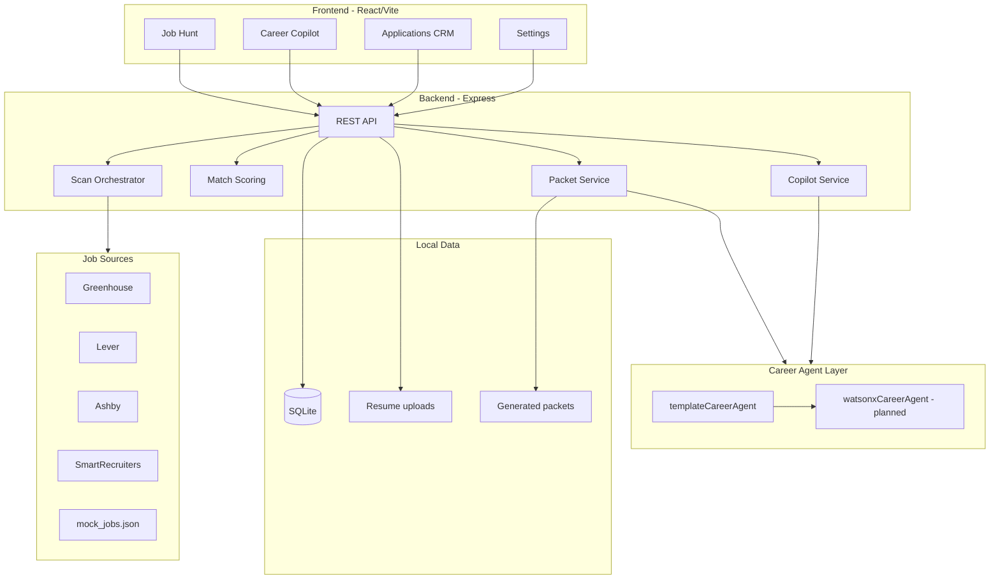

# Alligator Apply

**AI Career Operating System** — a semi-automated job hunt dashboard that ingests your resume, scans live job boards, scores fit, generates application materials, and guides next steps with a Career Copilot.

Built for portfolio and demo use: React + Node.js + SQLite, with explicit safety defaults (never auto-submits applications).

> The legacy Python/Streamlit app in the parent repo is reference-only. This stack is the canonical UI.

---

## Vision

Alligator Apply treats job hunting as an **operating system**, not a spreadsheet:

1. **Ingest** — parse resume skills and profile from PDF/DOCX
2. **Discover** — scan public ATS feeds (Greenhouse, Lever, Ashby, SmartRecruiters)
3. **Score** — resume-aware match breakdown with visa and quality signals
4. **Act** — application packets, CRM tracking, and Copilot guidance
5. **Stay safe** — human-in-the-loop; automation stops before submit

---

## Features

| Area | Status | Description |
|------|--------|-------------|
| Resume parsing | Live | PDF/DOCX text extraction + structured profile (skills, email, years) |
| Job scan | Live / mock | Background scan from 4 ATS adapters or `mock_jobs.json` |
| Match scoring | Live | Heuristic score with matched/missing skills and breakdown |
| Application packets | Live (template) | Cover letter, recruiter email, LinkedIn message, follow-up, resume tips |
| Career Copilot | Live (template) | Chat actions: explain match, resume tips, interview prep, recruiter message |
| Applications CRM | Live | Kanban + table, notes, follow-ups, CSV import/export |
| Auto-apply | Mock only | Playwright placeholder; pauses before submit |
| watsonx agent | Planned | Credentials detected → template fallback until LLM wired |
| Auth / multi-user | Not implemented | Single-user local SQLite |
| Career Health Score | Not implemented | Out of MVP scope |

Capabilities manifest: `GET /api/capabilities` (also shown on Settings page).

---

## Architecture



**Key paths**

| Layer | Location |
|-------|----------|
| Job sources | `backend/src/sources/` |
| Scan pipeline | `backend/src/services/jobScanService.js`, `scanOrchestrator.js` |
| Resume parsing | `backend/src/services/resumeParser.js` |
| Scoring context | `backend/src/services/resumeScoringContext.js`, `sources/matchScore.js` |
| Career agents | `backend/src/agents/` |
| Copilot | `backend/src/services/copilotService.js` |
| Capabilities | `backend/src/config/productCapabilities.js` |

---

## Screenshots

> Placeholder — add images to `docs/screenshots/` before publishing. See [docs/screenshots/README.md](docs/screenshots/README.md) for a capture checklist.

| Dashboard | Job Hunt | Copilot |
|-----------|----------|---------|
| *`docs/screenshots/01-dashboard.png`* | *`docs/screenshots/03-job-results.png`* | *`docs/screenshots/06-copilot.png`* |

---

## Local setup

### Prerequisites

- Node.js 18+
- npm

### 1. Clone and configure

```bash
cd alligator-apply
cp .env.example .env
```

Edit `.env` as needed. For an **offline portfolio demo**, set:

```env
MOCK_MODE=true
```

For **live job boards**, set `MOCK_MODE=false` and configure sources (see [Job sources](#job-sources-mock-vs-live)).

### 2. Install and run

```bash
# Terminal 1 — API
cd backend
npm install
npm run dev

# Terminal 2 — UI
cd frontend
npm install
npm run dev
```

| Service | URL |
|---------|-----|
| Frontend | http://localhost:5173 |
| API health | http://localhost:4000/api/health |

### 3. Run tests

```bash
cd backend
npm run test:all
```

Individual suites: `test:resume`, `test:scoring`, `test:packet`, `test:copilot`, `test:quality`, `test:providers`, `test:workday`, `test:sources`.

---

## Demo workflow (5–10 min)

Recommended path for GitHub README or portfolio video:

### Step 1 — Upload resume

1. Open **Job Hunt**
2. Upload a PDF or DOCX resume
3. Confirm parse status (skills and profile fields appear)

### Step 2 — Scan jobs

1. Set filters (keywords, location, remote, visa preferences in Settings)
2. Click **Run scan**
3. Wait for scan summary; browse **Recommended** vs **All** tabs

### Step 3 — Open a job

1. Click a row to open the **Job detail drawer**
2. Review match score breakdown, matched/missing skills, visa signals, rejection reasons

### Step 4 — See score explanation

1. In the drawer, click **Explain match** (or **Ask Copilot**)
2. Copilot opens at `/copilot?jobId=…&action=explain_match` with job context and a template explanation

### Step 5 — Generate application packet

1. Back in Job Hunt drawer, click **Generate Application Packet**
2. Preview cover letter, recruiter email, LinkedIn message, and resume improvements
3. Files also written to `backend/outputs/application_packets/` (gitignored)

### Step 6 — Ask Copilot

1. Try drawer quick actions: **Suggest resume changes**, **Prepare interview**, **Generate recruiter message**
2. Or open **Copilot** from the sidebar for pipeline-wide **Next action** recommendations

### Optional — Track application

- **Track Application** from job results → manage in **Applications** (Kanban/table)

---

## Job sources (mock vs live)

### Mock mode (default for demos)

`MOCK_MODE=true` loads sample jobs from `backend/data/mock_jobs.json`. No external API calls.

### Live mode

```env
MOCK_MODE=false
JOB_SOURCES=greenhouse,lever,ashby,smartrecruiters
GREENHOUSE_BOARDS=stripe,airbnb
LEVER_COMPANIES=spotify,palantir
ASHBY_BOARDS=Ashby
SMARTRECRUITERS_COMPANIES=SmartRecruiters
```

Default company targets: `backend/data/source_targets.json`. Env vars override the file.

```bash
cd backend
npm run test:sources          # uses MOCK_MODE from .env
node scripts/testSources.js greenhouse --live   # force live adapter test
```

### Source limitations

| Source | Limitations |
|--------|-------------|
| **Greenhouse** | Public boards only; known tokens required; no global search |
| **Lever** | Per-company JSON feed; keyword filters client-side |
| **Ashby** | Per-organization board; case-sensitive board name |
| **SmartRecruiters** | Paginated postings; minimal description fetch to limit polling |

Scans run sequentially with pauses between companies. Failed sources log errors and the scan continues.

### Company Registry (Settings UI)

When `MOCK_MODE=false`, scans resolve targets **registry-first**: enabled entries in the Company Registry table on **Settings** are used before legacy `source_targets`.

**Manual check (Phase 1E):**

1. Start backend (`npm run dev` in `backend/`) and frontend (`npm run dev` in `frontend/`).
2. Open **Settings** → **Company Registry**.
3. Confirm the table lists imported companies (run `npm run registry:import` in `backend/` if empty).
4. Use filters: search by company/token, filter by source, filter enabled/disabled.
5. Click **Add company / entry** — fill company name, source, board token; optional careers URL, tags, priority, enabled.
6. Toggle **Enabled** / **Disabled** on a row and confirm the button state updates.
7. Expand **Legacy Source Manager** (collapsed by default) to edit old per-source slugs — still used as fallback when no registry entries exist for a source.

Registry API (backend): `GET/POST /api/registry/companies`, `GET/POST/PATCH /api/registry/entries`, `POST /api/registry/entries/:id/toggle`, `GET /api/registry/tags`, `GET /api/registry/stats/summary`. Test with `npm run test:registry-api`.

### Workday (opt-in, Phase 2B)

Public careers via Workday CXS API — **not enabled by default**. Registry entries store CXS connection fields in `connection_payload`:

```json
{
  "tenant": "nvidia",
  "wdInstance": "wd5",
  "hostSlug": "nvidia",
  "site": "NVIDIAExternalCareerSite",
  "locale": "en-US",
  "pageSize": 20,
  "fetchDetails": false
}
```

Seed five enterprise targets (NVIDIA, Salesforce, Adobe, ServiceNow, Netflix):

```bash
cd backend
npm run registry:seed:workday
```

Enable scans only when ready:

```env
MOCK_MODE=false
JOB_SOURCES=greenhouse,lever,ashby,smartrecruiters,workday
```

Tests:

```bash
npm run test:workday              # unit + mock adapter
node scripts/testWorkdayAdapter.js --live   # optional NVIDIA live smoke
```

Workday jobs are never auto-apply eligible (manual review required).

---

## Pages

| Route | Purpose |
|-------|---------|
| `/dashboard` | KPI overview and quick start |
| `/job-hunt` | Resume upload, filters, scan, job results |
| `/applications` | CRM Kanban + table |
| `/copilot` | Career Copilot chat |
| `/analytics` | Pipeline statistics and charts |
| `/settings` | Profile, company registry, legacy sources, capabilities manifest |

---

## API overview

| Method | Path | Description |
|--------|------|-------------|
| GET | `/api/health` | Health check |
| GET | `/api/capabilities` | Feature manifest |
| GET/POST/DELETE | `/api/resume` | Resume status, upload, delete |
| GET | `/api/jobs` | Paginated jobs + filters |
| POST | `/api/jobs/scan` | Start background scan |
| GET | `/api/jobs/:id` | Job detail with scoring breakdown |
| POST | `/api/jobs/:id/packet` | Generate application packet |
| POST | `/api/copilot/chat` | Career Copilot query |
| GET/POST/PATCH | `/api/applications` | CRM CRUD |
| GET/PUT | `/api/settings` | User preferences |
| GET/POST | `/api/registry/companies` | Company registry list / create |
| GET/POST/PATCH | `/api/registry/entries` | Registry entries CRUD |
| POST | `/api/registry/entries/:id/toggle` | Enable or disable an entry |
| GET | `/api/registry/tags` | Tag catalog |
| GET | `/api/registry/stats/summary` | Registry counts by source |

---

## Limitations (MVP)

- **Single user** — no authentication; SQLite is local-only
- **Template AI** — packets and Copilot use deterministic templates unless watsonx is wired
- **No auto-submit** — `AUTO_SUBMIT=false`; Playwright apply is a placeholder
- **No scheduler** — scans are user-triggered
- **No Career Health Score** — not in scope
- **Legacy OpenAI key** — if set in `.env`, unused by this stack (legacy Python only)
- **Live scan variance** — job counts and listings change with external APIs

---

## Safety & git hygiene

These paths are **gitignored** — do not commit:

- `.env` (secrets)
- `backend/data/*.db` (local SQLite)
- `backend/uploads/**` (uploaded resumes)
- `backend/outputs/**` (generated packets)

Only `.env.example` with placeholder values is tracked. Run `git status` before push.

**Safety defaults**

- `AUTO_SUBMIT=false` — never auto-submit applications
- `MOCK_MODE=true` — safe offline demo unless you opt into live APIs
- Manual review gates for visa, EEO, salary, CAPTCHA, and final submit (when auto-apply is built)

---

## Roadmap

| Milestone | Status |
|-----------|--------|
| React dashboard + SQLite API | Done |
| Live ATS adapters (4 sources) | Done |
| Resume parsing (PDF/DOCX) | Done |
| Resume-based match scoring | Done |
| Application packet generation | Done (template) |
| Career Copilot + Job Hunt integration | Done (template) |
| Applications CRM | Done |
| Capabilities manifest | Done |
| Company Registry UI (Settings) | Done |
| Workday public CXS adapter (opt-in) | Done |
| Playwright guided auto-apply | Planned |
| watsonx LLM agent (packets + Copilot) | Planned |
| Auth + PostgreSQL + Docker | Out of MVP scope |
| Career Health Score | Not planned for MVP |

---

## Legacy

The Python/Streamlit app in `../alligator_apply/` remains for reference (OpenAI scoring, older packet flow). It is **not** wired to this React dashboard.

---

## License

Portfolio / demo project — add your license before public release.
